# AgriPilot : guide de l'utilisateur

Ce guide est écrit pour le personnel de la ferme, pas pour les informaticiens. Il explique les gestes de tous les
jours, rôle par rôle, avec le nom exact des boutons tels qu'ils apparaissent à l'écran. Les images viennent de
l'application elle-même (dossier `docs/reference/built/`).

Pour installer l'application, voir le [README](../README.md).

## Sommaire

1. [Pour commencer](#1-pour-commencer)
2. [Ce que chaque rôle voit et fait](#2-ce-que-chaque-rôle-voit-et-fait)
3. [Les gestes de la journée](#3-les-gestes-de-la-journée)
4. [Les alertes et ce qui les fait disparaître](#4-les-alertes-et-ce-qui-les-fait-disparaître)
5. [Les étiquettes QR et le scan](#5-les-étiquettes-qr-et-le-scan)
6. [Les rapports et l'impression](#6-les-rapports-et-limpression)
7. [Un chiffre vous semble faux ?](#7-un-chiffre-vous-semble-faux-)

---

## 1. Pour commencer

### Se connecter

1. Ouvrez l'adresse de l'application dans votre navigateur (Chrome ou Firefox sur ordinateur ; Chrome ou Safari sur téléphone).
2. Saisissez votre **Adresse e-mail** et votre **Mot de passe**, puis touchez **Se connecter**.
3. Après cinq erreurs de mot de passe, le compte est bloqué 15 minutes : attendez, ou demandez au Super administrateur.

### La double authentification (2FA)

Elle est **obligatoire** pour le Super administrateur, le Propriétaire, le Directeur de ferme et le Comptable (ceux qui voient l'argent ou
changent les droits). Les autres rôles peuvent l'activer dans **Mon compte**.

- **La première fois** : l'écran « Activer la double authentification » s'affiche. Scannez le QR code avec une application
  d'authentification (Google Authenticator, Authy, 2FAS), saisissez le code à 6 chiffres, puis **notez les 8 codes de secours** : ils ne sont affichés qu'une
  seule fois et chacun ne sert qu'une fois.
- **Ensuite** : après le mot de passe, saisissez le **Code de vérification** (6 chiffres, ou un code de secours) et touchez **Vérifier**.
- Téléphone perdu : utilisez un code de secours, puis refaites la configuration dans **Mon compte**.

### Choisir la ferme

En bas de la barre latérale (sur téléphone : le bouton à trois barres en haut à gauche), votre nom et le nom de la **ferme** active
s'affichent. Touchez-les pour changer de ferme. Le Propriétaire, l'Auditeur et le Super administrateur peuvent aussi choisir **Toutes les fermes**
(lecture seule). Tout ce que vous voyez se rapporte à la ferme active.

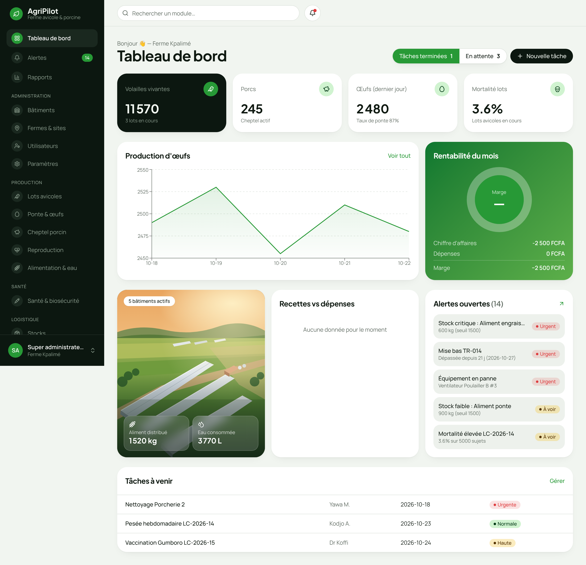

### Le tableau de bord, la cloche et la recherche

- Le **Tableau de bord** résume la journée : volailles vivantes, porcs, œufs, taux de ponte, mortalité, aliment et eau, **Tâches terminées**, **En attente**, **Tâches à venir**, alertes.
- La **cloche** en haut et le nombre à côté d'**Alertes** dans le menu comptent les alertes ouvertes que vous n'avez pas masquées.
- La zone **Rechercher un module…** en haut ouvre un écran par son nom.
- Sur la plupart des listes : la zone **Rechercher…**, un filtre de statut, le bouton **Ajouter** (si votre rôle peut saisir), le bouton **Exporter** (CSV, Excel), et à droite de chaque ligne les icônes pour modifier ou supprimer. Une icône **grisée** ne peut pas servir ; passez la souris dessus pour lire pourquoi (par exemple « Lot clôturé »).

---

## 2. Ce que chaque rôle voit et fait

Le menu ne montre que ce que votre rôle peut ouvrir. Si un bouton manque, c'est que votre rôle n'a pas ce droit.

| Rôle | En pratique |
|---|---|
| **Agent d'élevage** | Saisit mortalité, pesées, aliment et eau, ponte, actes de santé du terrain ; **Mes tâches** ; **Déclarer une panne**. Ne crée pas de tâche, ne voit ni l'argent ni les employés. |
| **Responsable avicole** / **porcin** | Gère ses lots, la ponte, l'alimentation, la santé ; crée les tâches et la feuille de présence ; déclare une panne ; lit les rapports sans l'argent. |
| **Vétérinaire** | Santé et biosécurité (vaccinations, traitements, diagnostics, plans) ; avance ses propres tâches. |
| **Responsable stock** / **Magasinier** | Stocks, mouvements, inventaires, fournisseurs, achats (le Magasinier réceptionne) ; avancent leurs propres tâches. |
| **Commercial** | Clients, devis, factures, encaissements. |
| **Comptable** | Dépenses et recettes, salaires du mois, paiements, avoirs, rapports avec l'argent. Ne voit pas les tâches. |
| **Directeur de ferme** | Tout ce qui touche à la ferme : lots, stocks, achats, tâches, équipements, personnel ; lit les ventes, la finance, les rapports. |
| **Propriétaire** / **Auditeur** | Lecture de tout ; le Propriétaire valide les achats et émet les avoirs. L'Auditeur ne modifie rien. |
| **Super administrateur** | Tout, plus les fermes, utilisateurs et paramètres. |

Le tableau complet des droits est dans le [README](../README.md#qui-peut-faire-quoi--personnel-tâches-équipements-rapports-qr-alertes).

---

## 3. Les gestes de la journée

Chaque recette dit **qui** la fait, **où** aller et **quels boutons** toucher.

### Ouvrir sa journée

*Tous les rôles.*

1. Ouvrez le **Tableau de bord** et lisez les chiffres de la veille.
2. Touchez la cloche ou **Alertes** : lisez les alertes (les rouges d'abord). Voir [partie 4](#4-les-alertes-et-ce-qui-les-fait-disparaître).
3. Si vous avez des tâches : **Tâches & personnel**, filtre **Mes tâches**.

### Saisir la ponte

*Agent d'élevage, Responsable avicole, Directeur.*

1. Menu **Ponte & œufs**, puis **Ajouter**.
2. Choisissez le **Lot** (un lot de pondeuses), la **Date**, puis **Œufs collectés**, **Œufs cassés** et **Mis en incubation** (0 par défaut).
3. **Enregistrer**. Le taux de ponte et de casse se calcule tout seul.

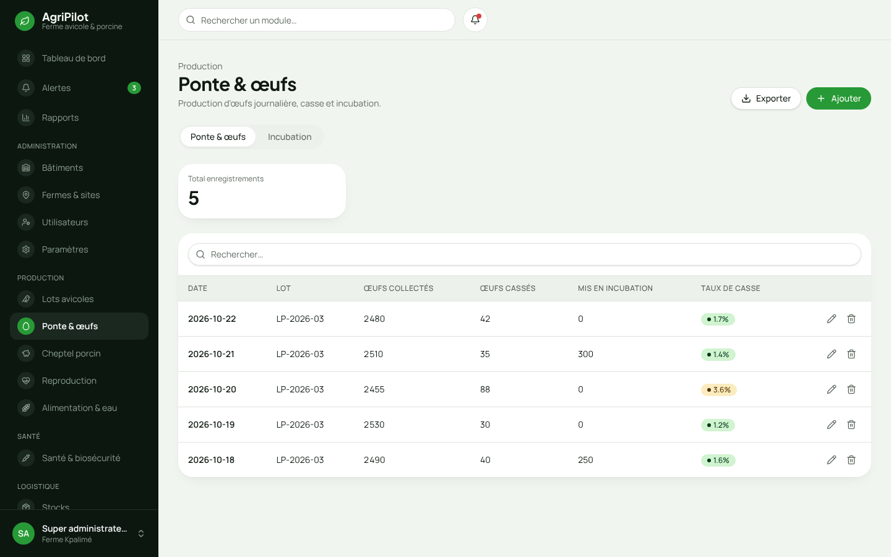

### Saisir une mortalité ou une pesée

1. Menu **Lots avicoles** (ou **Cheptel porcin**), ouvrez le lot en touchant son code.
2. Onglet **Mouvements**, **Ajouter**, **Type** « Mortalité », **Quantité**, **Date**, **Enregistrer**. Pour une pesée : onglet **Pesées**, **Ajouter**.
3. Le nombre de **Vivants** du lot suit : on ne le saisit jamais directement.

### Distribuer l'aliment

*Agent d'élevage, Responsables.*

1. Menu **Alimentation & eau**, onglet **Distributions**, **Ajouter**.
2. **Date**, **Type de cible** (**Lot** ou **Bâtiment**) et la cible, **Type d'aliment** (**Aliment** ou **Formule**) et l'aliment, **Quantité (kg)**, **Eau (L)** si vous la relevez.
3. **Enregistrer** : le stock de l'aliment baisse. Si le stock est insuffisant, un message le dit et rien n'est enregistré.

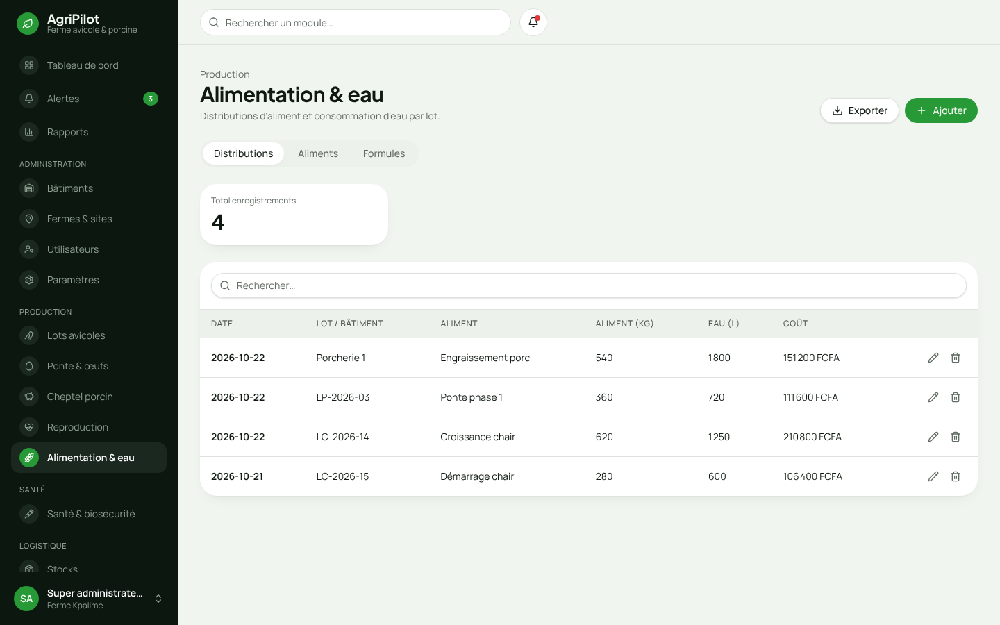

### Déclarer une panne

*Agent d'élevage, Responsables, Directeur.*

1. Menu **Équipements**. Sur la ligne de l'équipement, touchez l'icône **Déclarer une panne** (triangle).
2. Vérifiez la **Date**, décrivez la **Description** (« Le moteur ne démarre plus »), **Enregistrer**.
3. L'état devient **En panne** et l'alerte rouge « Équipement en panne » apparaît pour tout le monde.

Le **Directeur** referme la panne : sur la même ligne, icône **Intervention** (clé), type **Corrective**, **Description**, **Coût (FCFA)** si connu, case « Répare la panne du … » cochée, **État après intervention** (« Bon »), **Enregistrer**. L'équipement repasse à **Bon** et l'alerte disparaît.

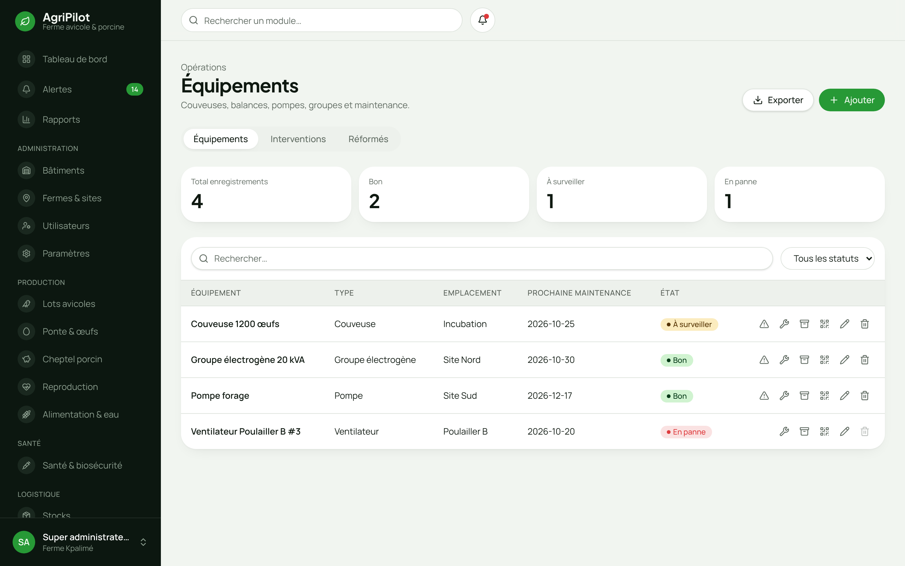

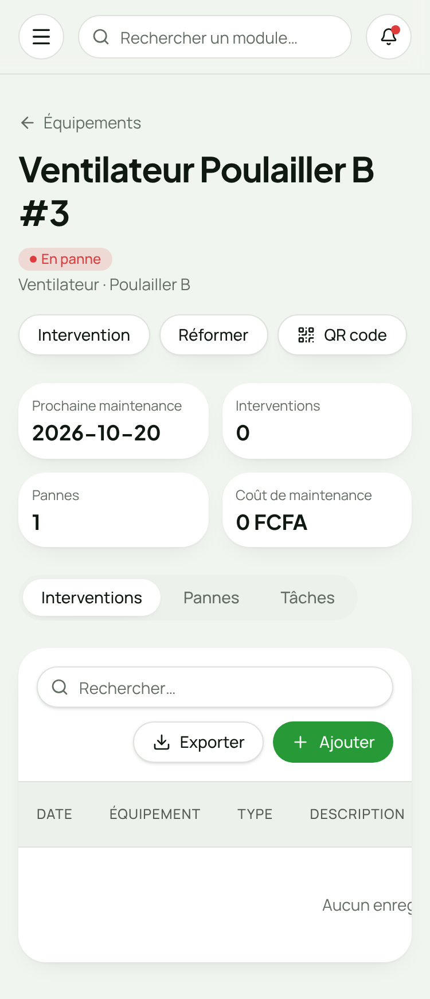

### Terminer une tâche avec photo

*Le responsable de la tâche, depuis un téléphone de préférence.*

1. Menu **Tâches & personnel**, filtre **Mes tâches**.
2. Sur la ligne : **Démarrer** (la tâche passe à **En cours**).
3. Quand c'est fait : **Terminer**. Vérifiez la **Date de réalisation**, joignez la **Photo (preuve)** (JPEG, PNG ou WebP, 5 Mo au plus), **Enregistrer**.
4. La ligne devient **Terminée**. Si la tâche se répète (chaque jour, semaine ou mois), une nouvelle ligne **À faire** apparaît pour la date suivante.
5. **Voir la preuve** ouvre la photo dans un nouvel onglet. Une erreur ? **Rouvrir** remet la tâche à faire.

Vous ne voyez **Démarrer** et **Terminer** que sur **vos** tâches (celles de l'employé lié à votre compte). Les autres sont en lecture seule.

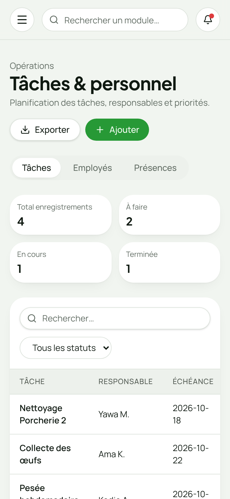

### Créer une tâche, saisir la présence

*Responsable avicole ou porcin, Directeur (la présence : aussi eux).*

- **Créer une tâche** : **Tâches & personnel**, **Ajouter** ; renseignez **Tâche**, **Responsable**, **Échéance**, **Heure**, **Priorité**, **Récurrence**, et **Concerne** (Rien, Lot, Bâtiment ou Équipement), puis **Enregistrer**. Une tâche terminée ne se modifie plus : **Rouvrir** d'abord.
- **Présences du jour** : onglet **Présences**, **Ajouter**. La **Date** est celle d'aujourd'hui ; chaque employé en poste a une ligne : **Statut** (Présent par défaut, Absent, Congé, Maladie), **Heures** (pour une présence seulement), **Note**. **Enregistrer** : rouvrir le même jour montre la feuille déjà saisie.
- **Employés** (Directeur) : onglet **Employés**, **Ajouter** : **Nom affiché** (« Kodjo A. »), **Poste**, **Contrat**, **Date d'embauche**, **Salaire mensuel (FCFA)**, et **Compte utilisateur** pour lier l'employé à son identifiant (il aura alors **Mes tâches**).

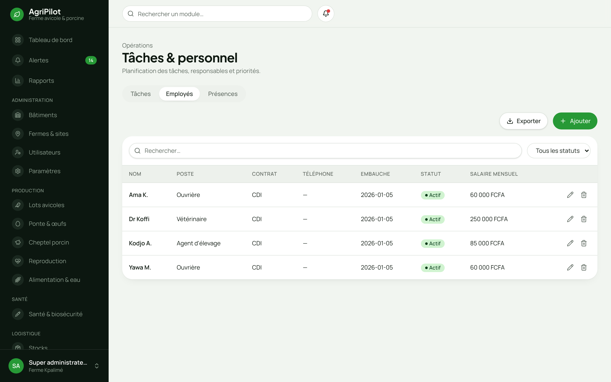

### Enregistrer une vente et un paiement

*Commercial (Comptable pour les encaissements).*

1. **Clients** : **Ajouter** le client s'il n'existe pas (**Nom**, **Type**, **Téléphone**, **Ville**).
2. **Ventes** : **Ajouter**. Choisissez le **Client**, remplissez les lignes (**Type ligne 1** : Lot, Animal, Œufs, Article, Prestation ; la source, la **Quantité**, le **Prix unitaire**). Le **Total** s'affiche.
3. Pour encaisser tout de suite, cochez **Paiement comptant**, saisissez le **Montant (FCFA)** et le **Mode de paiement**. **Enregistrer** crée un brouillon : il ne touche ni au lot, ni au stock.
4. Sur la ligne de la facture : **Émettre** (le numéro `FA-…` est attribué, le lot ou le stock baisse), puis **Encaisser** pour chaque paiement reçu (un reçu `RC-…` est créé).
5. Pour imprimer : ouvrez la facture, **Imprimer la facture**.

Un lot ou des œufs en **délai d'attente** après un traitement ne peuvent pas être vendus pendant cette période.

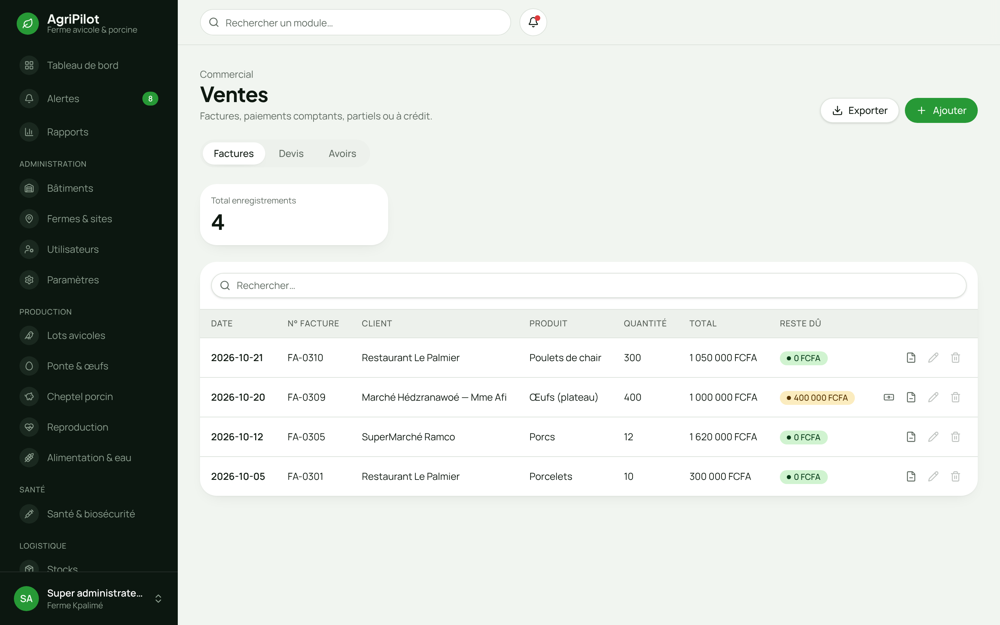

### Saisir les salaires du mois

*Comptable.*

1. **Dépenses & recettes** (Finance), **Ajouter**.
2. Touchez **Salaires du mois**, choisissez le **Mois des salaires**, touchez **Pré-remplir** : le libellé, la catégorie Salaires et le total des salaires mensuels des employés en poste sont remplis. Si une écriture existe déjà pour ce mois, un avertissement le dit.
3. Corrigez au besoin (primes, départs), puis **Enregistrer**. Rien n'est enregistré sans votre validation.

Le coût d'une intervention de maintenance apparaît tout seul sous la catégorie **Entretien** (« Maintenance … ») : **ne le saisissez pas**.

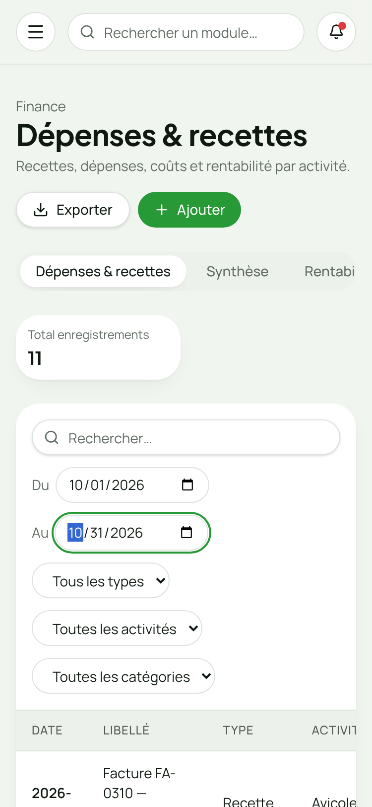

### Réceptionner une commande, compter le stock

*Magasinier, Responsable stock.*

- **Réception** : **Achats**, ouvrez la commande (statut **Commandée**), **Réceptionner** : **Date de réception**, **Quantité reçue** de chaque ligne, **N° de lot** et **Péremption** pour les produits périssables.
- **Mouvement de stock** : **Stocks**, ouvrez l'article, onglet **Mouvements**, **Ajouter** (entrée, sortie, ajustement). Une sortie qui rendrait le stock négatif est refusée.
- **Inventaire** : onglet **Inventaires**, **Ajouter**, comptez chaque article, enregistrez ; le Responsable stock **valide** : les écarts deviennent des ajustements.

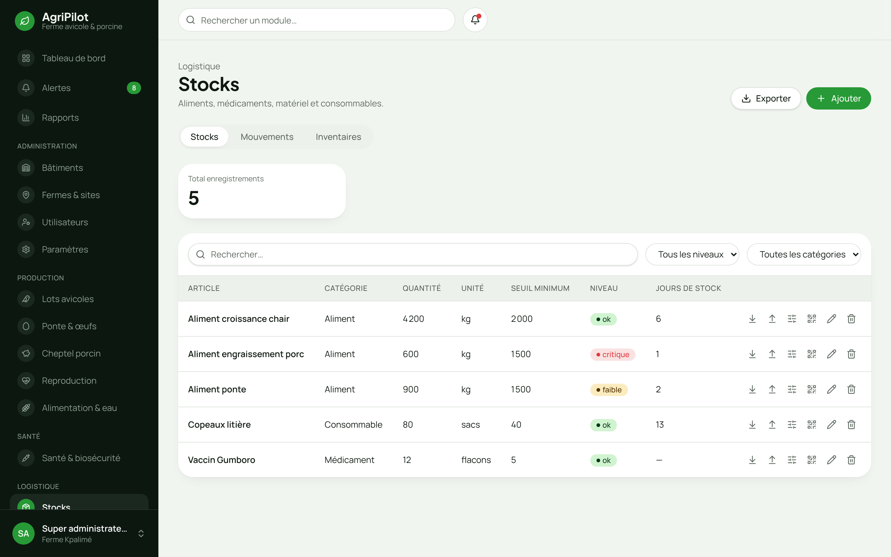

### Vaccins, traitements (Vétérinaire)

Menu **Santé & biosécurité**, onglet **Interventions**, **Ajouter** : **Type** (Vaccination, Traitement, Désinfection, Diagnostic), cible **Lot**, **Animal** ou **Bâtiment**, **Statut** (**Planifié** ou **Réalisé**), **Produit en stock** (le stock baisse), **Dose**. Un traitement avec délai d'attente bloque la vente du lot jusqu'à la fin du délai. Un acte planifié se termine avec **Marquer réalisé**.

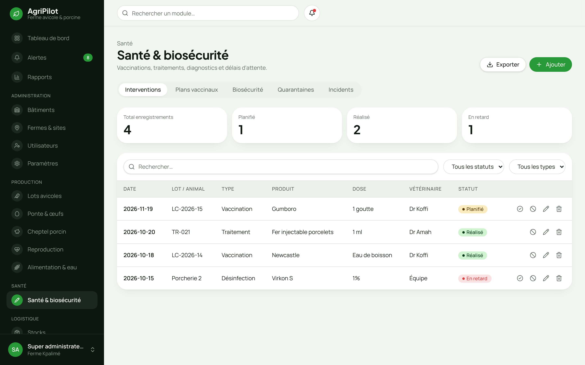

### Lire les rapports, masquer une alerte, exporter

Voir les parties 4, 6 et ci-dessous.

### Exporter une liste

Sur toute liste : **Exporter**, puis **CSV** ou **Excel**. Le fichier contient les lignes de la liste avec ses filtres actuels (et **pas** les montants que votre rôle ne peut pas voir). Dans un CSV, les nombres décimaux s'écrivent avec une **virgule** : Excel en français les lit comme des nombres. **Exporter**, puis **Étiquettes QR**, ouvre la planche d'étiquettes (partie 5).

---

## 4. Les alertes et ce qui les fait disparaître

Menu **Alertes** (ou la cloche). Les alertes sont calculées automatiquement ; vous ne les saisissez pas. Les **rouges** (urgentes) sont en premier.

| Alerte | Elle disparaît quand… |
|---|---|
| **Stock faible / critique : article** | une entrée de stock (réception d'achat, ajustement) remonte le niveau au-dessus du seuil. |
| **Mortalité élevée {lot}** | la mortalité repasse sous le seuil (elle ne baisse que par une correction de saisie). |
| **Mise bas {truie}** (retard) | la mise bas est enregistrée dans **Reproduction**. |
| **Vaccination à venir / en retard**, **Traitement en retard**, **Désinfection en retard** | l'acte est **réalisé** (ou annulé) dans **Santé & biosécurité**. |
| **Produit périmé / bientôt périmé** | le lot de produit est sorti du stock ou sa date corrigée. |
| **Tâche en retard** | la tâche est **Terminée** (une tâche récurrente laisse la suivante à sa date). |
| **Maintenance due** | une **Intervention** est enregistrée avec une prochaine date plus tard. |
| **Équipement en panne** | une intervention **Corrective** répare la panne. |
| **Créance FA-…** | la facture est payée (**Encaisser**) ou annulée. |

### Masquer une alerte

Vous n'avez pas à agir sur une alerte pour l'instant ? Touchez l'icône de l'œil barré, **Masquer l'alerte**, sur sa carte. Elle disparaît **pour vous seul** pendant 7 jours (réglage du Super administrateur), ou jusqu'à ce qu'elle s'aggrave. La cloche baisse d'un.

- Pour la revoir : **Afficher les alertes masquées (n)** sous le titre, puis **Réafficher** sur sa carte.
- Masquer ne règle **rien** : le problème reste, et les rapports comptent toujours l'alerte.

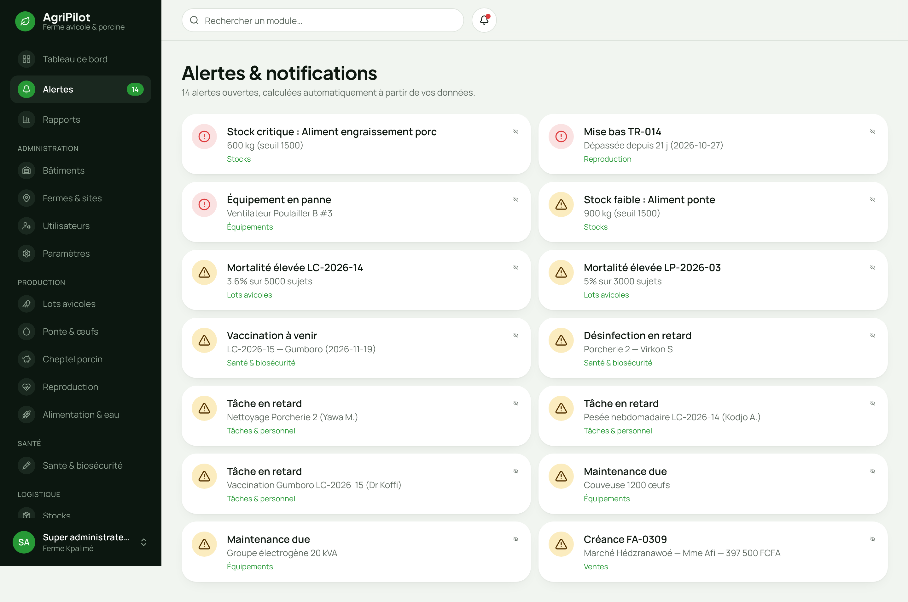

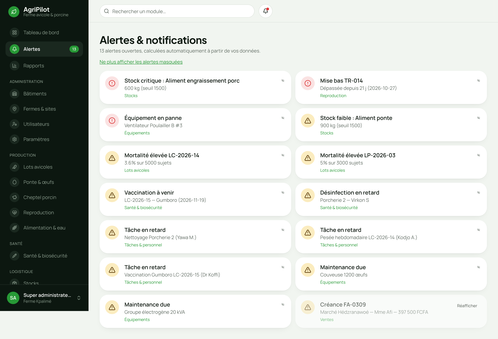

---

## 5. Les étiquettes QR et le scan

Un lot, un animal, un bâtiment, un article de stock (médicaments compris) ou un équipement peut porter une étiquette QR. En la scannant, on arrive directement sur sa fiche. Le QR ne contient qu'une adresse : **sans compte et sans droit de lecture, il ne montre rien**.

### Afficher ou imprimer un QR

- Sur une liste (lots, porcs, bâtiments, stocks, équipements) : touchez l'icône **QR code** de la ligne. La fenêtre « QR code — … » montre l'image, le nom, la ferme et l'adresse ; **Imprimer l'étiquette** l'imprime.
- Sur la fiche d'un équipement ou d'un bâtiment : bouton **QR code**.

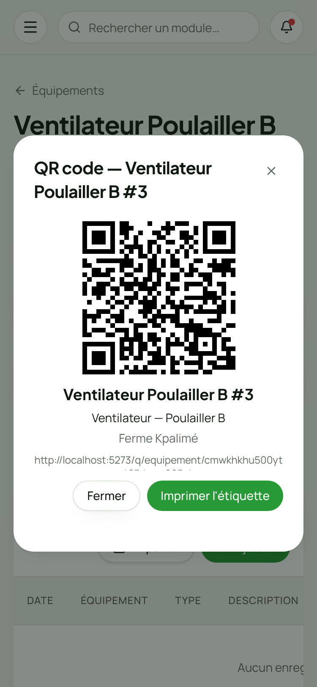

### Imprimer une planche d'étiquettes

1. Sur la liste voulue, filtrez (par exemple un type de lot), puis **Exporter**, **Étiquettes QR**.
2. La fenêtre « Étiquettes QR » montre les étiquettes de la page affichée (60 au plus). **Imprimer**.
3. Papier : feuilles adhésives A4 de **3 × 8 étiquettes (63,5 × 33,9 mm)**, impression à l'échelle **100 %** (sans « ajuster à la page »). Avec un autre format d'étiquettes, réglez l'échelle.

### Scanner

- **Avec l'appareil photo du téléphone** : le plus simple. Visez l'étiquette, touchez l'adresse proposée ; l'application s'ouvre sur la fiche (connectez-vous si on vous le demande).
- **Dans l'application** : ouvrez votre nom en bas du menu, **Scanner un QR code**. Autorisez la caméra, visez l'étiquette. Si votre navigateur ne sait pas lire les QR, collez le lien dans **Lien ou code de l'étiquette**, **Ouvrir**.
- **« QR code inconnu ou inaccessible »** : l'objet n'existe plus, ou votre rôle n'a pas le droit de le voir, ou il est dans une ferme qui ne vous est pas affectée. Touchez **Retour au tableau de bord**.

---

## 6. Les rapports et l'impression

Menu **Rapports**. Choisissez l'onglet : **Synthèse** (la situation du jour), **Quotidien**, **Hebdomadaire**, **Mensuel**, **Annuel**, **Sanitaire**, **Zootechnique**, puis la période (**Jour**, **Semaine du**, **Mois**, **Année**, ou **Du** / **Au**).

- Les rapports sont **calculés** : il n'y a rien à valider.
- Vous ne voyez que les sections de votre rôle : sans accès à la finance, pas de section **Finance** ni de chiffre d'affaires.
- Les effectifs sont ceux de la **fin** de la période ; les niveaux de stock sont ceux d'**aujourd'hui** (c'est écrit dans le rapport).
- **CSV** et **Excel** téléchargent le fichier `rapport-{type}-{début}_{fin}`. **Imprimer / PDF** ouvre l'impression du navigateur : choisissez « Enregistrer au format PDF » pour un fichier.

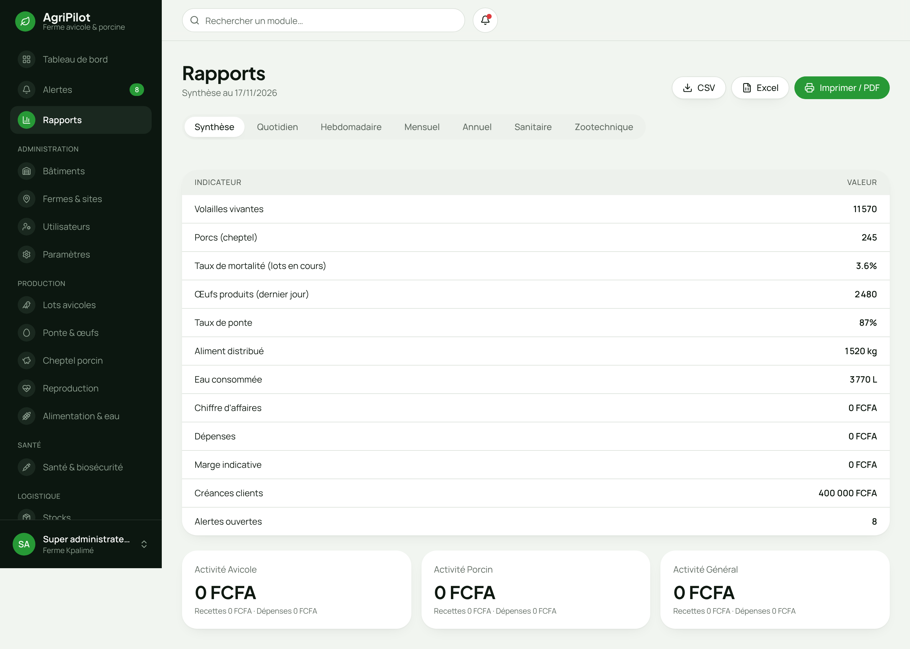

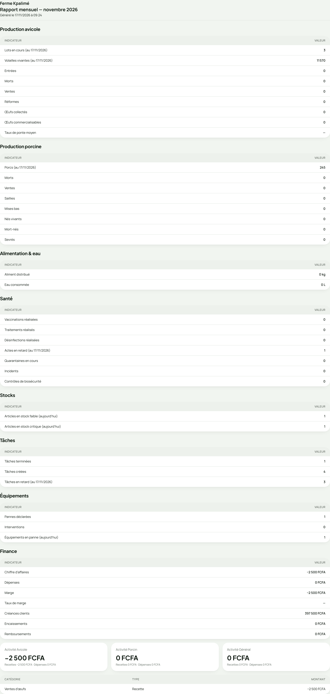

---

## 7. Un chiffre vous semble faux ?

Aucun total n'est saisi à la main : les effectifs, les stocks et l'argent sont toujours la **somme des opérations enregistrées**. Pour corriger un chiffre, on corrige l'opération à l'origine, jamais le total.

1. **Cherchez l'opération.** L'effectif d'un lot : onglet **Mouvements** du lot. Un stock : onglet **Mouvements** de l'article. Une dépense ou une recette : **Dépenses & recettes**. Le **Journal d'audit** (menu **Journal d'audit**) dit qui a fait quoi et quand.
2. **Corrigez au bon endroit.**
   - Une **saisie du jour** (mortalité, ponte, distribution, présence) : icône **Modifier** ou **Supprimer** sur la ligne.
   - Un **stock** : enregistrez un **ajustement** (ou comptez un **inventaire**) ; un inventaire validé verrouille les mouvements plus anciens de cet article.
   - Une **facture émise** : on ne la modifie pas. Émettez un **avoir** (**Avoir**, avec ou sans retour des marchandises), ou **Annuler** la facture si elle n'a ni paiement ni avoir.
   - Un **lot clôturé** par erreur : **Rouvrir**. Une **tâche** terminée par erreur : **Rouvrir**.
   - Une **dépense d'entretien** : corrigez l'**intervention** dont elle vient (elle n'est pas modifiable en finance).
   - Un **paiement** faux : supprimez-le puis ré-encaissez.
3. **Des icônes grisées ?** Passez la souris : la raison est écrite (« Lot clôturé », « Enregistrement verrouillé », « Tâche terminée — rouvrez-la »…).
4. **Toujours un doute ?** Notez le chiffre, l'écran et l'heure, et prévenez le Directeur de ferme ou le Super administrateur : le journal d'audit permet de retrouver l'opération.
